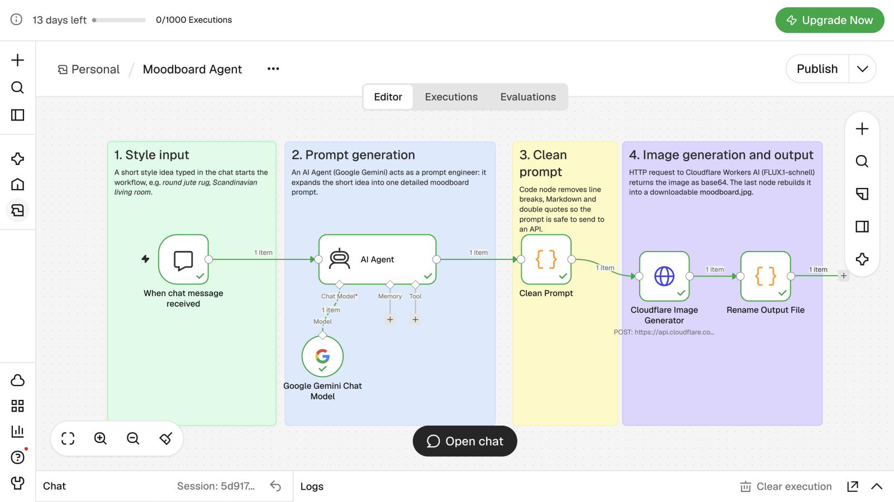
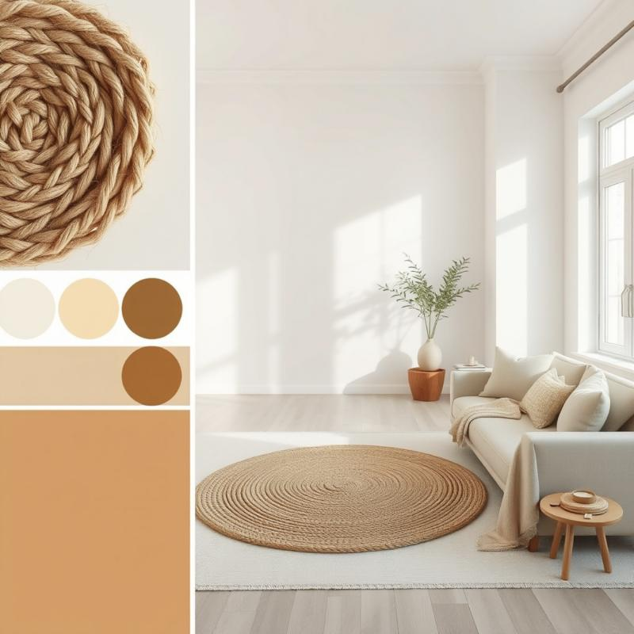

# AI Agents for E-commerce Market Intelligence (n8n)

**Built during the Wayfair n8n AI Agent Engineering Externship via Extern · Nov 2026 – Jan 2027 · in progress**

## Overview

I am building a set of AI agents in n8n that take a home-goods category team from a style idea to trend research, competitor insight, content ideas and one dashboard. Every project below adds one agent, and the last one connects them all.

The projects follow the Extern externship brief and use public or program-provided data. They are learning projects, not systems running at Wayfair.

## Projects

| # | Project | What it does | Status |
|---|---|---|---|
| 1 | **Moodboard Agent** | Turns a short style idea into a detailed image prompt with Google Gemini, cleans it, and generates a moodboard image with Cloudflare Workers AI (FLUX.1-schnell). | ✅ Done |
| 2 | Consumer Trend Discovery Agent | Collects and analyses product data, blogs and social media to surface design trends. | ⏳ Next |
| 3 | Competitor Monitoring Agent | Tracks competitor launches, pricing updates and campaigns. | ⏳ Planned |
| 4 | AI Insights & Content Agent | Turns trend signals into summaries, blog ideas and campaign captions. | ⏳ Planned |
| 5 | Market Intelligence Dashboard | Combines all outputs in a live, auto-updating Google Sheets dashboard. | ⏳ Planned |

## Project 1: Moodboard Agent



```
Chat input ──> AI Agent (Google Gemini) ──> Clean Prompt (JavaScript) ──> Cloudflare Workers AI ──> moodboard.jpg
```

| Step | Node | What happens |
|---|---|---|
| 1. Style input | Chat Trigger | A short idea starts the workflow, e.g. *"Moodboard collage for a round jute rug, Scandinavian living room"*. |
| 2. Prompt generation | AI Agent + Google Gemini | Gemini acts as a prompt engineer and expands the idea into one detailed moodboard prompt. |
| 3. Clean prompt | Code (JavaScript) | Removes line breaks, Markdown and double quotes so the prompt is safe to send to an API. |
| 4. Image generation | HTTP Request | Sends the prompt to Cloudflare Workers AI (FLUX.1-schnell), which returns the image as Base64. |
| 5. Output | Code (JavaScript) | Rebuilds the Base64 text into a downloadable `moodboard.jpg`. |

**Result** (input: *"Moodboard collage for a round jute rug: grid of close-up rug textures, colour swatches and a Scandinavian living room, neutral palette, warm wood, soft daylight"*):



**What I changed and learned**

- The agent first wrapped the prompt in an introduction, so I tightened the system message to return only the final prompt.
- The image API returns Base64 text, not a file; the last Code node is what turns it into a viewable image.
- The same input sometimes gave one room instead of a collage, so I made the style input more specific (asking explicitly for a grid of textures and swatches).
- I grouped the workflow into four coloured, labelled sections so anyone can follow it.

## Technology

- **Automation:** n8n workflows, chat trigger, node orchestration
- **AI:** LLM agent with Google Gemini; image generation with Cloudflare Workers AI (FLUX.1-schnell)
- **Integrations:** HTTP requests with header authentication
- **Transformations:** JavaScript Code nodes, JSON and Base64 handling

## Running the workflows

1. Import the JSON files from [`workflows/`](workflows) into n8n.
2. Add your own credentials: a Google Gemini API key, and a Cloudflare API token as a Header Auth credential (`Authorization: Bearer <token>`).
3. In the Cloudflare node, replace `YOUR_ACCOUNT_ID` in the URL with your own Cloudflare account ID.

No API keys, tokens or account IDs are stored in this repository. See [SECURITY.md](SECURITY.md).

## About

Built by Pien Ruigrok as part of the Wayfair n8n AI Agent Engineering Externship via Extern.
